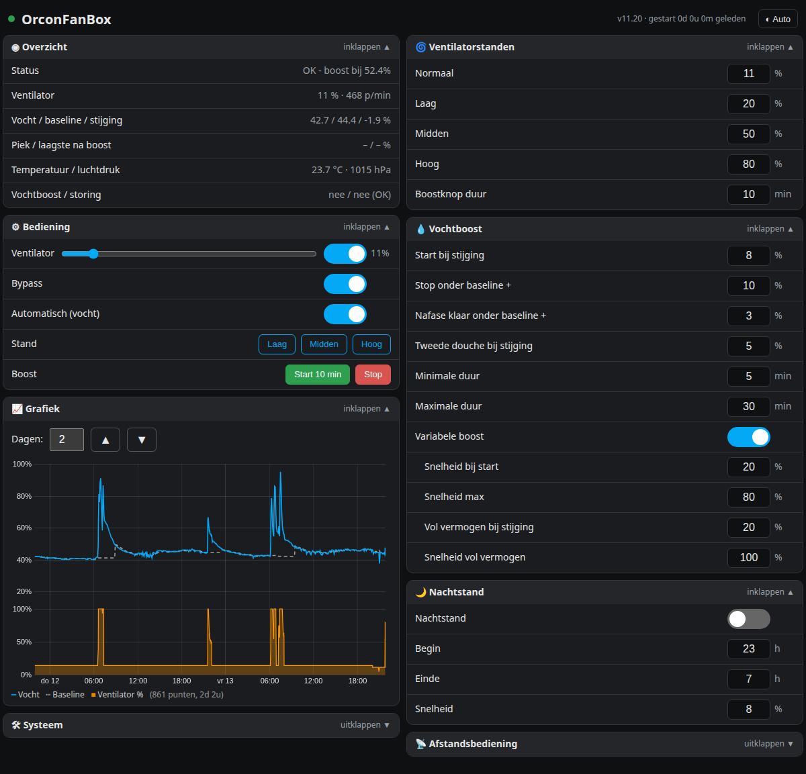
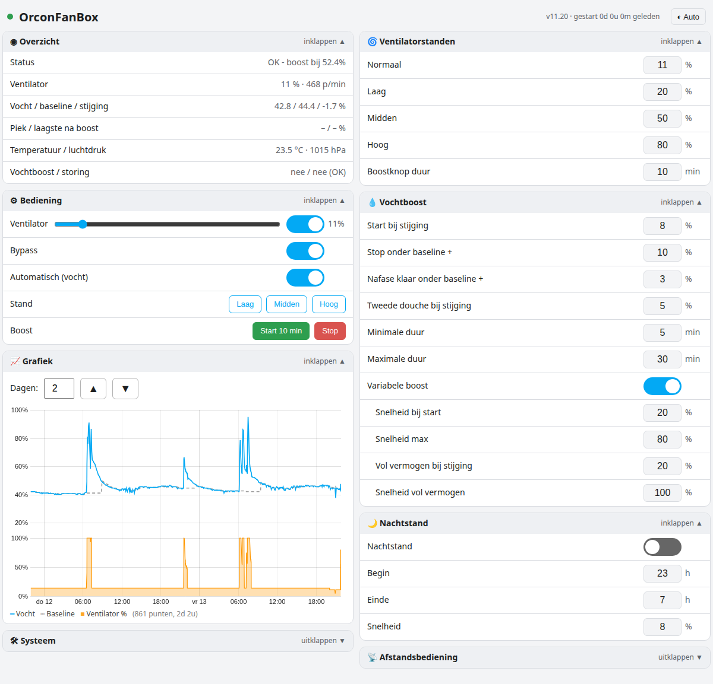
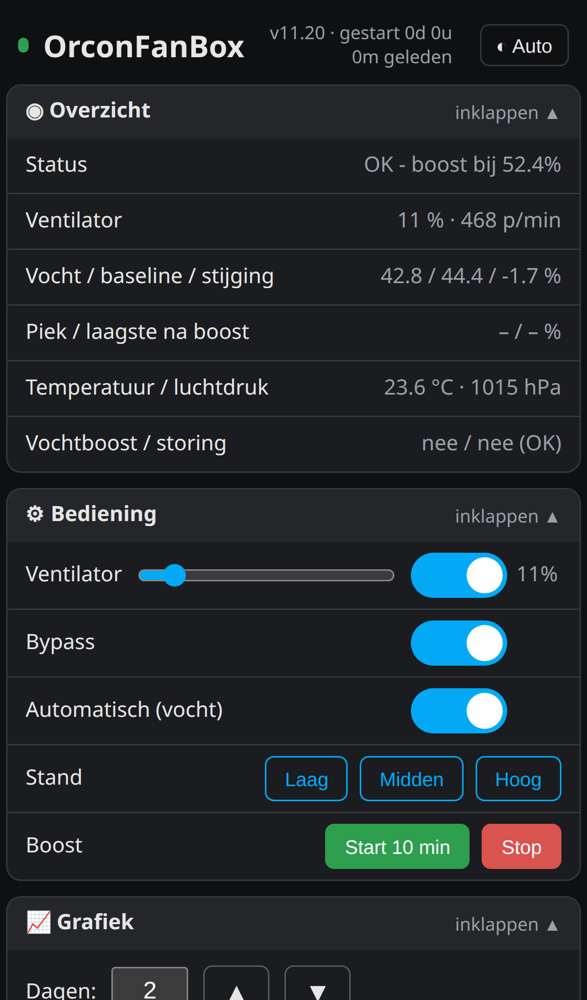
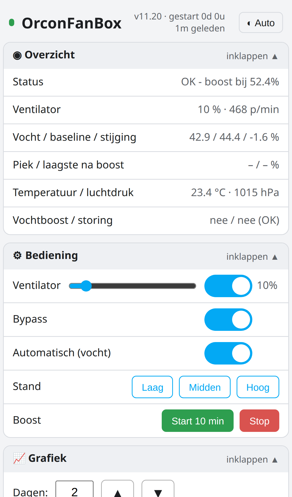
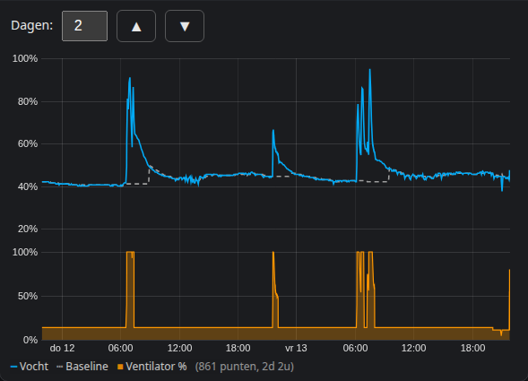
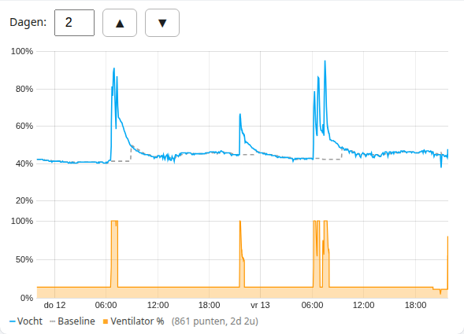
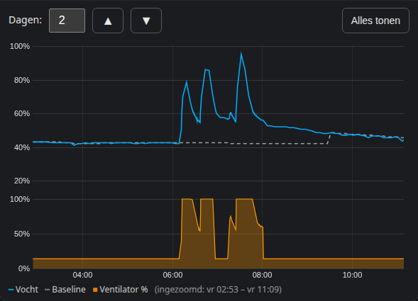

# OrconFanBox für Home Assistant

ESPHome-Firmware (v11.20) für einen D1 mini (ESP8266), der ein **Orcon MVS-15**-Lüftungsgerät steuert – mit feuchtegesteuertem Boost, eigener Webseite, 7-Tage-Diagramm und vollständiger Home-Assistant-Integration.

> [!IMPORTANT]
> Alle Firmware-Dateien liegen im Ordner [`../firmware`](../firmware). Legen Sie **alle** Dateien in denselben ESPHome-Ordner; die YAML verwendet die `.h`- und `.js`-Dateien.

| Dunkel | Hell |
|---|---|
|  |  |

## Funktionen

**Lüfter**
- Drehzahl 0–100 % per PWM an D6, Tachomessung an D5;
- Bypass-Relais an D8, mit dem Lüfter gekoppelt (Lüfter an = Bypass an);
- Stufen Niedrig, Mittel und Hoch (einstellbar) und eine Boost-Taste mit einstellbarer Dauer;
- Störungserkennung: Lüfter an, aber keine Drehzahl → `Orcon_Fan_Failure`.

**Feuchte-Boost (BME280 an D1/D2)**
- die Firmware lernt die normale Luftfeuchtigkeit (*Baseline*) selbst;
- Boost startet bei einem einstellbaren **Anstieg** über der Baseline (Standard +8 Prozentpunkte);
- **variabler Boost**: die Drehzahl folgt dem Anstieg, von *Drehzahl beim Start* (40 %) bis *max. Drehzahl* (80 %), und ab *Anstieg für volle Leistung* (+20) auf *volle Drehzahl* (100 %);
- nach dem Spitzenwert wird die Drehzahl schrittweise reduziert;
- minimale und maximale Boost-Dauer, Nachphase und Erkennung einer zweiten Dusche.

**Nachtmodus** mit Start- und Endzeit und eigener Drehzahl.

**Fernbedienung**: das Signal der originalen Orcon-Bedienung (D7) wird gemessen (Pulsbreite, Periode, Frequenz) und kann optional übernommen werden; die Pulswerte je Stufe sind kalibrierbar.

**Zuverlässige Speicherung**: alle Einstellungen liegen in einem festen, kompakten Speicherblock im Flash und überstehen Neustart, Stromausfall und Firmware-Update.

**7-Tage-Diagramm**: Feuchte, Baseline und Lüfterdrehzahl, alle 5 Minuten und bei jeder Drehzahländerung ein Punkt. Gespeichert in einem freien Flash-Bereich (48 KB), bleibt also auch nach einem Neustart erhalten. Die Anzahl der Tage (1–7) wählen Sie über dem Diagramm.

## Webseite

Öffnen Sie `http://orconfanbox.local` oder die IP-Adresse (Standard-Login **admin / admin**, änderbar oben in der YAML: `web_gebruiker` / `web_wachtwoord`).

- Gruppen: Übersicht, Bedienung, Diagramm, System, Lüfterstufen, Feuchte-Boost, Nachtmodus, Fernbedienung (Beschriftung auf Niederländisch);
- jede Gruppe ist ein- und ausklappbar; die Seite merkt sich Ihre Wahl;
- Eingabefelder zeigen nur Wert und Einheit; der erlaubte Bereich erscheint neben dem Feld, sobald Sie hineintippen;
- geeignet für PC (zwei Spalten) und Smartphone (eine Spalte).
- Taste oben rechts für ◐ Auto / ☀ Hell / ☾ Dunkel;
- Zoomen im Diagramm: mit der Maus einen Bereich wählen oder am Smartphone waagerecht wischen; Doppelklick oder **Alles tonen** führt zurück.

| Smartphone Dunkel | Smartphone Hell |
|---|---|
|  |  |
|  |  |

Auf eine Dusche gezoomt (mit der Maus ziehen oder am Smartphone waagerecht wischen; Doppelklick oder **Alles tonen** zurück):

**Diagnose:** `http://<ip>/diag` zeigt Neustartgrund, freien Speicher, Laufzeit, Diagrammpunkte und die niedrigsten Speicherwerte dieser und der vorherigen Sitzung.

## Inhalt

- [`../firmware/orconfanbox.yaml`](../firmware/orconfanbox.yaml) – ESPHome-Konfiguration
- `../firmware/orcon_opslag.h` – fester Speicherblock für die Einstellungen
- `../firmware/orcon_grafiek.h` – Diagramm im Flash, Startseite und `/diag`
- `../firmware/orcon_d7.h` – Messung der Fernbedienung an D7
- `../firmware/orcon_webgui.js` – Webseite
- `../firmware/secrets.example.yaml` – Vorlage für Ihre Passwörter
- [`dashboard/orconfanbox-card.yaml`](dashboard/orconfanbox-card.yaml) – Home-Assistant-Dashboardkarte
- [`FIRMWARE_INSTALLIEREN.md`](FIRMWARE_INSTALLIEREN.md) – Firmware auf den D1 mini flashen
- [`INSTALLATION.md`](INSTALLATION.md) – Anschluss und Inbetriebnahme

## Home-Assistant-Entitäten

Die Entitäts-IDs basieren auf dem Gerätenamen (z. B. `sensor.orconfanbox_orcon_air_humidity`). Prüfen Sie immer die Entitätenliste Ihres ESPHome-Geräts.

| Typ | Entitäten |
|---|---|
| Lüfter | `Orcon_Fan_Speed` |
| Schalter | `Orcon_Fan_Bypass`, `Orcon_Humidity_Automatic`, `Orcon_Humidity_Variable_Boost`, `Orcon_Night_Mode`, `Orcon_Remote_Control` |
| Tasten | `Orcon_Fan_Low`, `Orcon_Fan_Medium`, `Orcon_Fan_High`, `Orcon_Fan_Boost_15_Minutes`, `Orcon_Fan_Boost_Cancel` |
| Sensoren | `Orcon_Fan_Percentage`, `Orcon_Fan_Tacho`, `Orcon_Fan_Speed_Requested`, `Orcon_Air_Temp`, `Orcon_Air_Humidity`, `Orcon_Air_Pressure`, `Orcon_Humidity_Baseline`, `Orcon_Humidity_Rise`, `Orcon_Humidity_Peak`, `Orcon_Humidity_Post_Min`, `Orcon_Remote_Pulse_us`, `Orcon_Remote_Period_us`, `Orcon_Remote_Freq_Hz` |
| Binärsensoren | `Orcon_Fan_Failure`, `Orcon_Humidity_Boost` |
| Textsensoren | `Orcon_Status_Info`, `Orcon_Fan_Status`, `Orcon_Remote_Stand` |
| Einstellungen (Zahlen) | `Orcon_Normal_Fan_Speed`, `Orcon_Fan_Low_Speed`, `Orcon_Fan_Medium_Speed`, `Orcon_Fan_High_Speed`, `Orcon_Fan_Boost_Minutes`, `Orcon_Humidity_Rise_Start`, `Orcon_Humidity_Boost_Stop`, `Orcon_Humidity_Rise_Stop`, `Orcon_Humidity_Rise_Restart`, `Orcon_Humidity_Min_Boost_Minutes`, `Orcon_Humidity_Max_Boost_Minutes`, `Orcon_Humidity_Fan_Speed`, `Orcon_Humidity_Boost_Min_Speed`, `Orcon_Humidity_Full_Rise`, `Orcon_Humidity_Full_Speed`, `Orcon_Night_Start_Hour`, `Orcon_Night_End_Hour`, `Orcon_Night_Fan_Speed`, `Orcon_Remote_Auto_us`, `Orcon_Remote_Afwezig_us`, `Orcon_Remote_Stand1_us`, `Orcon_Remote_Stand2_us`, `Orcon_Remote_Stand3_us`, `Orcon_Remote_Tolerance_us` |

## Sicherheit

Schalten Sie die Anlage spannungsfrei und lassen Sie Arbeiten an 230 V von einer Fachkraft ausführen.
