# OrconFanBox for Home Assistant

ESPHome firmware (v11.27) for a D1 mini (ESP8266) that controls an **Orcon MVS-15** ventilation unit, with humidity-driven boost, its own web page, a 7-day chart and full Home Assistant integration.

> [!IMPORTANT]
> All firmware files are in [`../firmware`](../firmware). Put **all** of them in the same ESPHome folder; the YAML uses the `.h` and `.js` files.

| Dark | Light |
|---|---|
| 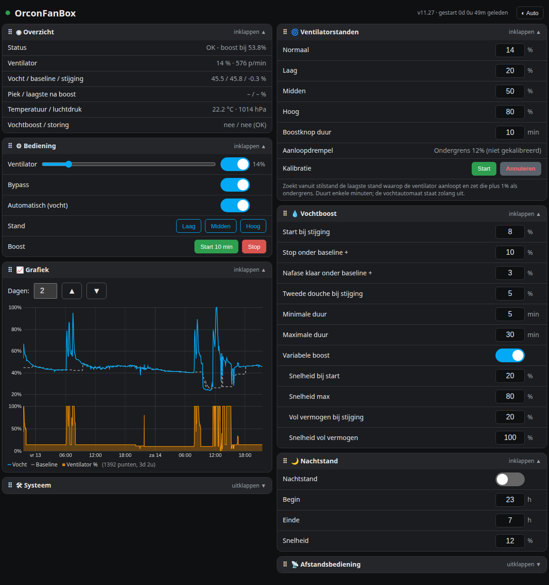 | 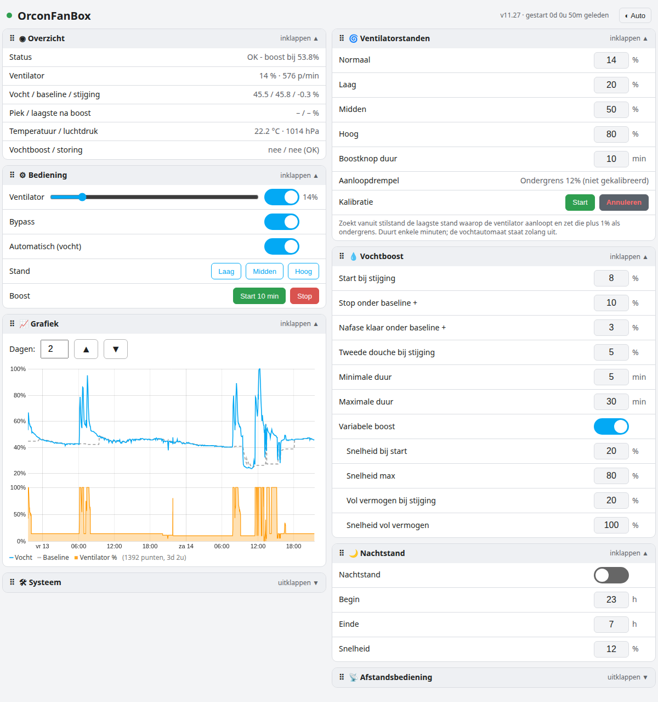 |

## Features

**Fan**
- speed 0–100 % via PWM on D6, tachometer on D5;
- bypass relay on D8, coupled to the fan (fan on = bypass on);
- Low, Medium and High presets (adjustable) and a boost button with adjustable duration;
- fault detection: fan on but no rpm → `Orcon_Fan_Failure`.

**Humidity boost (BME280 on D1/D2)**
- the firmware learns the normal humidity (*baseline*) by itself;
- boost starts at an adjustable **rise** above the baseline (default +8 percentage points);
- **variable boost**: speed follows the rise, from *speed at start* (40 %) to *max speed* (80 %), and at *full-power rise* (+20) to *full-power speed* (100 %);
- after the peak the speed ramps down gradually;
- minimum and maximum boost time, after-phase and detection of a second shower.

**Night mode** with start and end hour and its own speed.

**Remote control**: the original Orcon control signal (D7) is measured (pulse width, period, frequency) and can optionally be followed; pulse values per mode are calibratable.

**Reliable storage**: all settings live in one fixed, compact storage block in flash and survive restarts, power loss and firmware updates.

**7-day chart**: humidity, baseline and fan speed, a point every 5 minutes and on every speed change. Stored in a free flash area (48 KB), so it survives restarts. Choose 1–7 days above the chart.

## Web page

Open `http://orconfanbox.local` or the box's IP address (default login **admin / admin**, change `web_gebruiker` / `web_wachtwoord` at the top of the YAML).

- groups: Overview, Control, Chart, System, Fan presets, Humidity boost, Night mode, Remote control (labels are in Dutch);
- every group can be collapsed; the page remembers your choice;
- input fields show value and unit only; the allowed range appears next to the field when you tap it;
- works on PC (two columns) and phone (one column).
- button at the top right for ◐ Auto / ☀ Light / ☾ Dark;
- zoom into the chart: select a range with the mouse or swipe horizontally on a phone; double-click or **Alles tonen** to go back.

| Phone Dark | Phone Light |
|---|---|
| 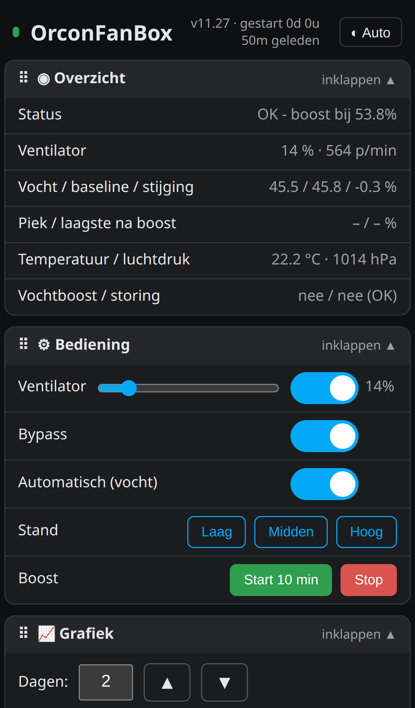 | 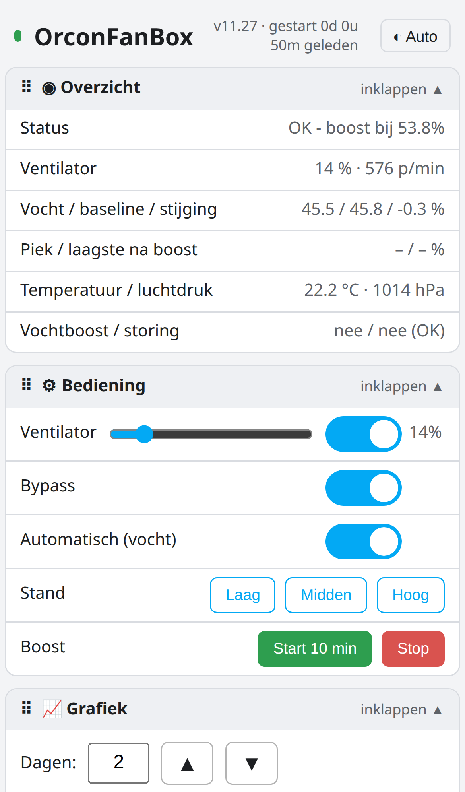 |
| 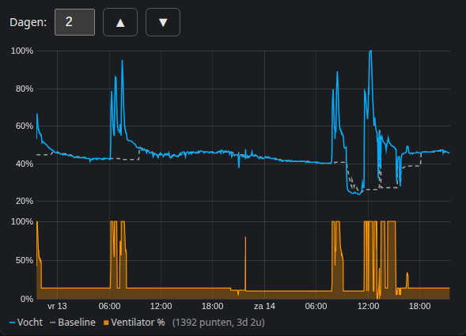 | 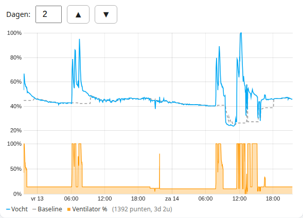 |

Zoomed in on one shower (drag with the mouse or swipe horizontally on a phone; double-click or **Alles tonen** to go back):

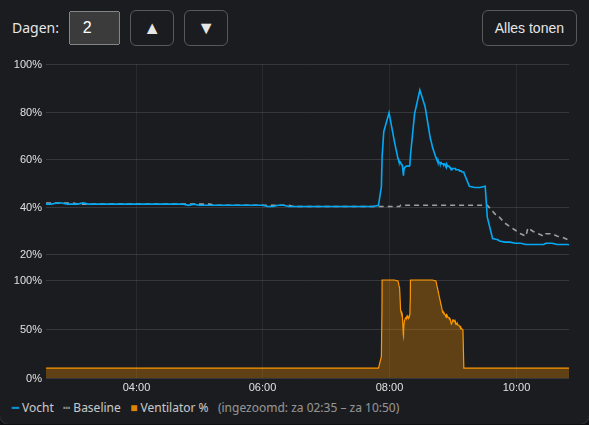

**Diagnostics:** `http://<ip>/diag` shows reset reason, free memory, uptime, chart points and the lowest memory values of this and the previous session.

## Setup without Wi-Fi credentials in the firmware

The firmware contains **no Wi-Fi credentials**. On first boot (and after a factory reset) the box opens the network **OrconFanBox Setup**. Connect to it and the setup page `http://192.168.4.1` opens by itself.

The setup page has two steps:

1. **Wi-Fi** – pick your 2.4 GHz network from the list and enter its password.
2. **Web page password** – choose a new password of 5 to 23 characters, or click **Overslaan** (skip) to keep `admin`.

The setup network stays on until something has been configured.

| Step 1 Wi-Fi | Step 2 password |
|---|---|
| 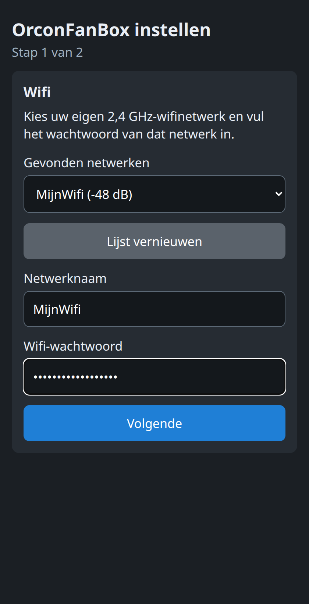 | 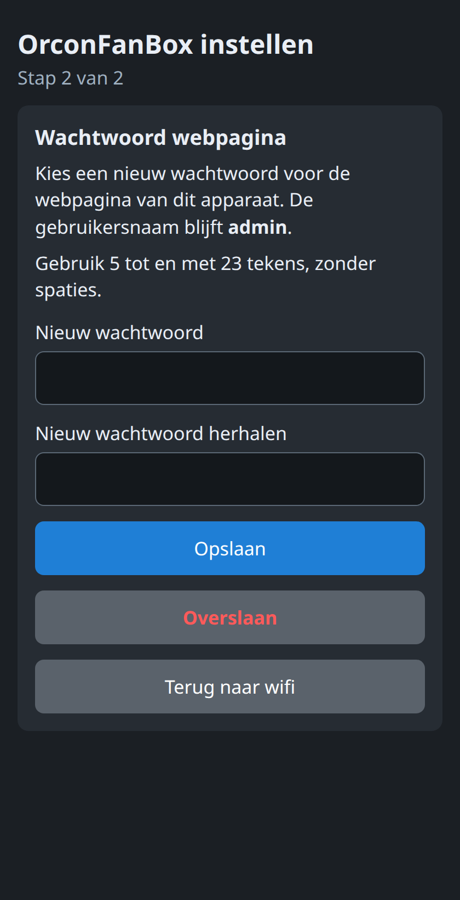 |

## Factory reset

Two ways, same result:

- press the RST button on the D1 mini **three times briefly**;
- click **Fabrieksreset** under **Systeem** on the web page.

The Wi-Fi credentials are erased and the web page password returns to `admin`. **Your settings and measurements are kept**, including the chart. The setup network then starts again.

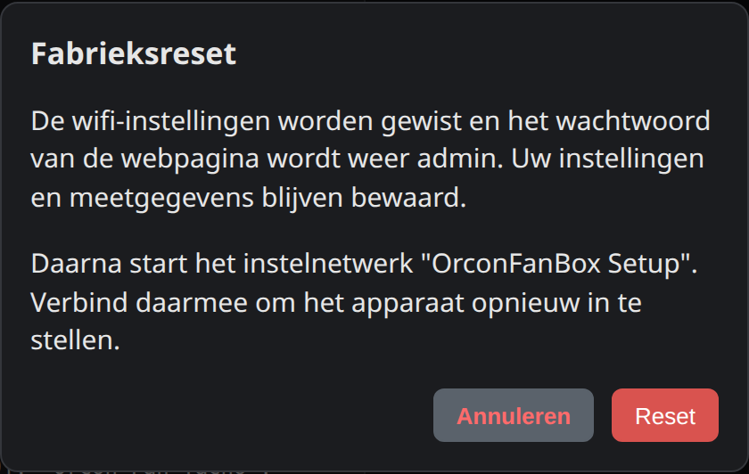

## Start-up threshold and calibration

An Orcon MVS-15 will not start below a certain level. On the author's unit that is 11%: below it the fan stays still, even with the level set to 10%. That is why the **lowest settable value** for Normal, Night, Low, Medium and High is **12%** by default.

If your unit has a different threshold, use the calibration in the **Ventilatorstanden** group:

1. Click **Start** next to Aanloopdrempel.
2. The humidity automation is switched off temporarily and the fan is stopped.
3. The box tries 6%, 7%, 8% and so on until the fan starts, and checks that value three times from standstill.
4. The value found plus 1% becomes the new lower limit. The humidity automation is then switched back on and the fan returns to its previous level.

Calibration takes a few minutes and the limit is kept across a restart. **Annuleren** stops it halfway.

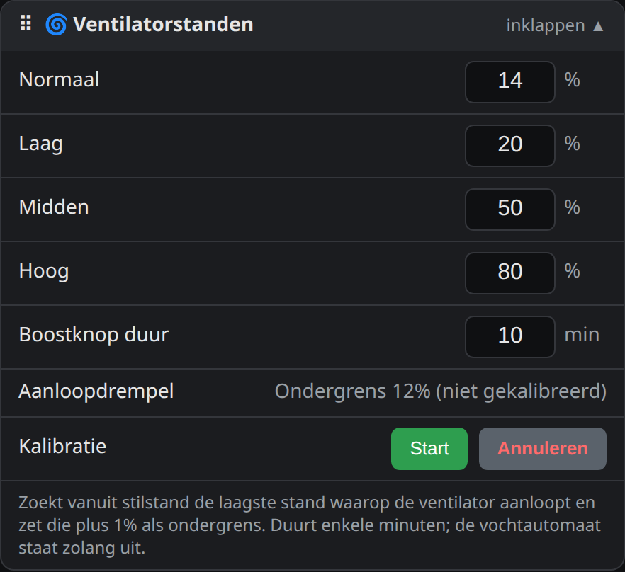

## Moving the groups

Every group has a handle **⠿** on the left of its header. Drag a group to another position with it, including to the other column. The order is remembered per device in your browser. **Standaard herstellen** under **Systeem** restores the original order.

## Contents

- [`../firmware/orconfanbox.yaml`](../firmware/orconfanbox.yaml) – ESPHome configuration
- `../firmware/orcon_opslag.h` – fixed storage block for settings
- `../firmware/orcon_grafiek.h` – flash chart, start page and `/diag`
- `../firmware/orcon_d7.h` – remote-control measurement on D7
- `../firmware/smit_setup.h` – setup page of the setup network and the factory reset
- `../firmware/bron/` – the separate source files of the web page
- `../firmware/orcon_webgui.js` – web page
- `../firmware/secrets.example.yaml` – template for your passwords
- [`dashboard/orconfanbox-card.yaml`](dashboard/orconfanbox-card.yaml) – Home Assistant dashboard card
- [`FLASH_FIRMWARE.md`](FLASH_FIRMWARE.md) – flashing the D1 mini
- [`INSTALLATION.md`](INSTALLATION.md) – wiring and first start

## Home Assistant entities

Entity IDs are based on the device name (e.g. `sensor.orconfanbox_orcon_air_humidity`). Always check the entity list of your ESPHome device.

| Type | Entities |
|---|---|
| Fan | `Orcon_Fan_Speed` |
| Switches | `Orcon_Fan_Bypass`, `Orcon_Humidity_Automatic`, `Orcon_Humidity_Variable_Boost`, `Orcon_Night_Mode`, `Orcon_Remote_Control` |
| Buttons | `Orcon_Fan_Low`, `Orcon_Fan_Medium`, `Orcon_Fan_High`, `Orcon_Fan_Boost_15_Minutes`, `Orcon_Fan_Boost_Cancel` |
| Sensors | `Orcon_Fan_Percentage`, `Orcon_Fan_Tacho`, `Orcon_Fan_Speed_Requested`, `Orcon_Air_Temp`, `Orcon_Air_Humidity`, `Orcon_Air_Pressure`, `Orcon_Humidity_Baseline`, `Orcon_Humidity_Rise`, `Orcon_Humidity_Peak`, `Orcon_Humidity_Post_Min`, `Orcon_Remote_Pulse_us`, `Orcon_Remote_Period_us`, `Orcon_Remote_Freq_Hz` |
| Binary sensors | `Orcon_Fan_Failure`, `Orcon_Humidity_Boost` |
| Text sensors | `Orcon_Status_Info`, `Orcon_Fan_Status`, `Orcon_Remote_Stand` |
| Settings (numbers) | `Orcon_Normal_Fan_Speed`, `Orcon_Fan_Low_Speed`, `Orcon_Fan_Medium_Speed`, `Orcon_Fan_High_Speed`, `Orcon_Fan_Boost_Minutes`, `Orcon_Humidity_Rise_Start`, `Orcon_Humidity_Boost_Stop`, `Orcon_Humidity_Rise_Stop`, `Orcon_Humidity_Rise_Restart`, `Orcon_Humidity_Min_Boost_Minutes`, `Orcon_Humidity_Max_Boost_Minutes`, `Orcon_Humidity_Fan_Speed`, `Orcon_Humidity_Boost_Min_Speed`, `Orcon_Humidity_Full_Rise`, `Orcon_Humidity_Full_Speed`, `Orcon_Night_Start_Hour`, `Orcon_Night_End_Hour`, `Orcon_Night_Fan_Speed`, `Orcon_Remote_Auto_us`, `Orcon_Remote_Afwezig_us`, `Orcon_Remote_Stand1_us`, `Orcon_Remote_Stand2_us`, `Orcon_Remote_Stand3_us`, `Orcon_Remote_Tolerance_us` |

## Safety

Disconnect the installation from mains power and have work on 230 V carried out by a qualified person.
