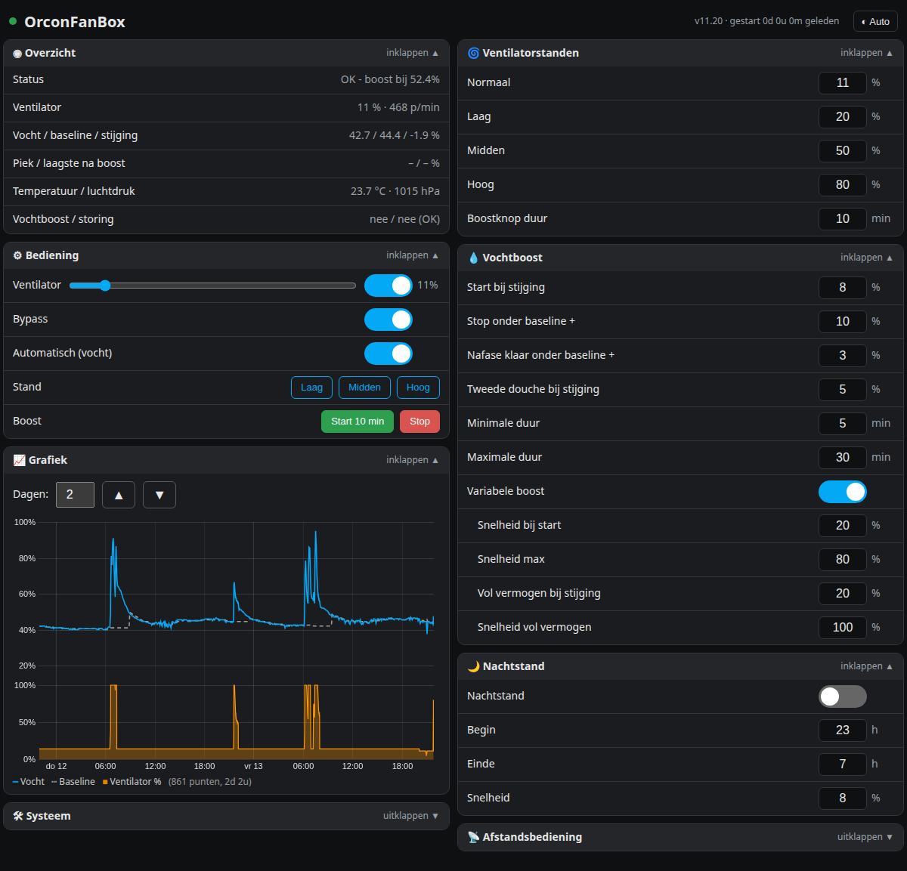
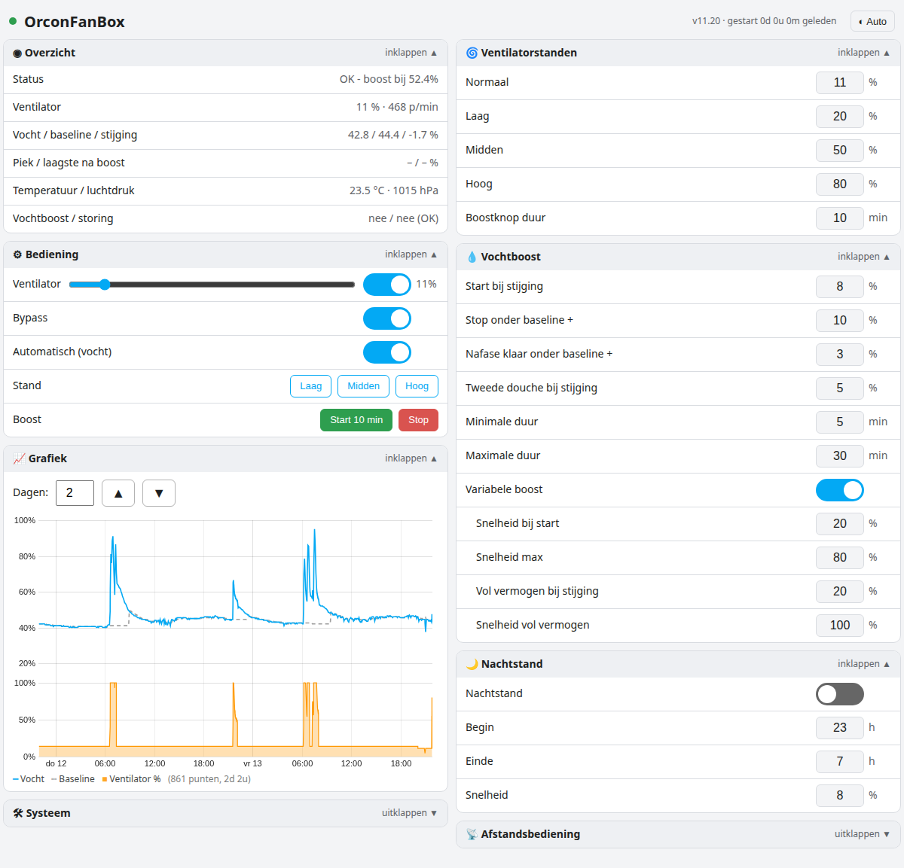
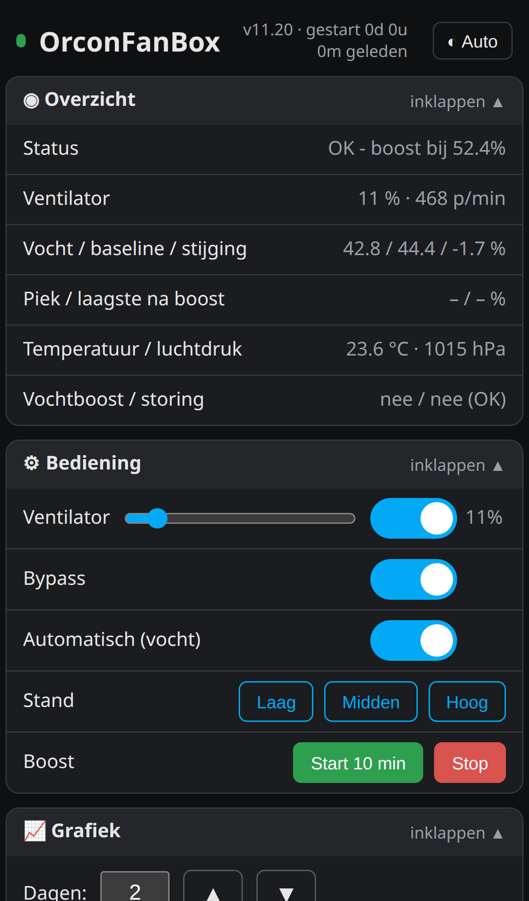
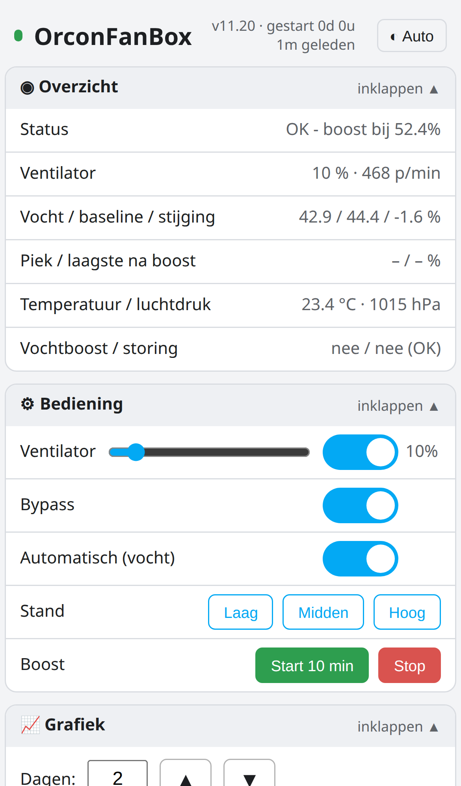
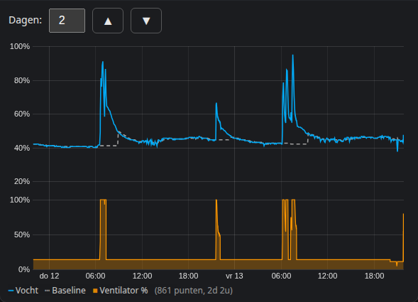
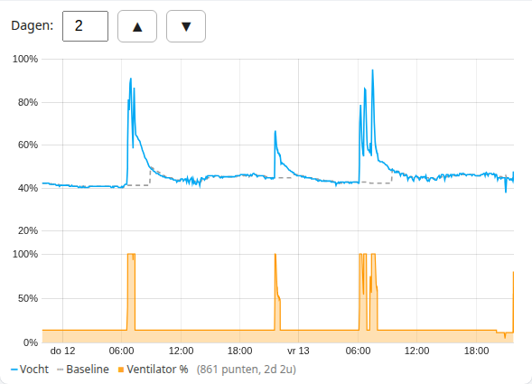
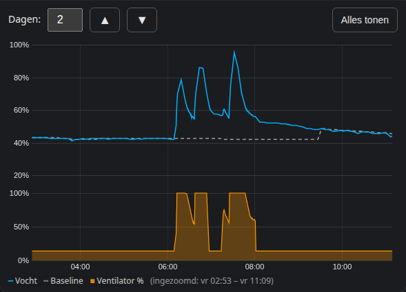

# OrconFanBox voor Home Assistant

ESPHome-firmware (v11.20) voor een D1 mini (ESP8266) die een **Orcon MVS-15**-ventilatie-unit aanstuurt, met vochtgestuurde boost, een eigen webpagina, een grafiek van 7 dagen en volledige Home Assistant-integratie.

> [!IMPORTANT]
> Alle firmwarebestanden staan in de map [`../firmware`](../firmware). Zet ze **allemaal** in dezelfde map in ESPHome; de YAML gebruikt de `.h`- en `.js`-bestanden.

| Donker | Licht |
|---|---|
|  |  |

## Functies

**Ventilator**
- snelheid 0–100 % via PWM op D6, met tachometermeting op D5;
- bypassrelais op D8, gekoppeld aan de ventilator (aan = bypass aan);
- standen Laag, Midden en Hoog (instelbaar) en een boostknop met instelbare duur;
- storingsdetectie: ventilator aan maar geen toerental → `Orcon_Fan_Failure`.

**Vochtboost (BME280 op D1/D2)**
- de firmware leert zelf de normale luchtvochtigheid (*baseline*);
- boost start bij een instelbare **stijging** boven de baseline (standaard +8 procentpunt);
- **variabele boost**: de snelheid loopt mee met de stijging, van *snelheid bij start* (40 %) tot *snelheid max* (80 %), en bij *vol vermogen bij stijging* (+20) naar *snelheid vol vermogen* (100 %);
- na de piek bouwt de snelheid geleidelijk af in plaats van in één keer;
- minimale en maximale boostduur, nafase en herkenning van een tweede douchebeurt.

**Nachtstand** met begin- en eindtijd en een eigen snelheid.

**Afstandsbediening**: de originele Orcon-bediening (D7) wordt uitgelezen (pulsbreedte, periode, frequentie) en kan desgewenst gevolgd worden; de pulswaarden per stand zijn kalibreerbaar.

**Betrouwbaar opslaan**: alle instellingen staan in één vast, compact opslagblok in de flash en overleven herstart, stroomstoring en firmware-update.

**Grafiek 7 dagen**: vocht, baseline en ventilatorsnelheid, elke 5 minuten én bij elke snelheidsverandering een punt. Opgeslagen in een vrij deel van de flash (48 KB), dus ook na een herstart nog beschikbaar. Het aantal dagen (1–7) kiest u zelf boven de grafiek.

## Webpagina

Open `http://orconfanbox.local` of het IP-adres van de box (inlog standaard **admin / admin**, aan te passen bovenin de YAML: `web_gebruiker` / `web_wachtwoord`).

- groepen: Overzicht, Bediening, Grafiek, Systeem, Ventilatorstanden, Vochtboost, Nachtstand, Afstandsbediening;
- elke groep is in- en uitklapbaar; de pagina onthoudt uw keuze;
- Nederlandse namen op de pagina; de namen in Home Assistant blijven ongewijzigd;
- invulvakken tonen alleen waarde en eenheid; de toegestane grens verschijnt links naast het vak zodra u erin tikt;
- geschikt voor pc (twee kolommen) en telefoon (één kolom).
- knop rechtsboven voor ◐ Auto / ☀ Licht / ☾ Donker;
- inzoomen in de grafiek: met de muis een stuk selecteren of op de telefoon horizontaal vegen; dubbelklikken of **Alles tonen** gaat terug.

| Telefoon Donker | Telefoon Licht |
|---|---|
|  |  |
|  |  |

Ingezoomd op één douchebeurt (met de muis slepen, of op de telefoon horizontaal vegen; dubbelklik of **Alles tonen** gaat terug):

**Diagnose:** `http://<ip>/diag` toont herstartreden, vrij geheugen, uptime, het aantal grafiekpunten en de laagste geheugenwaarden van deze en de vorige sessie.

## Inhoud van deze repository

- [`../firmware/orconfanbox.yaml`](../firmware/orconfanbox.yaml) – ESPHome-configuratie
- `../firmware/orcon_opslag.h` – vast opslagblok voor de instellingen
- `../firmware/orcon_grafiek.h` – grafiek in de flash, startpagina en `/diag`
- `../firmware/orcon_d7.h` – meting van de afstandsbediening op D7
- `../firmware/orcon_webgui.js` – webpagina
- `../firmware/secrets.example.yaml` – voorbeeld voor uw wachtwoorden
- [`dashboard/orconfanbox-card.yaml`](dashboard/orconfanbox-card.yaml) – Home Assistant-dashboardkaart
- [`FIRMWARE_INSTALLEREN.md`](FIRMWARE_INSTALLEREN.md) – firmware op de D1 mini zetten
- [`INSTALLATIE.md`](INSTALLATIE.md) – aansluiten en ingebruikname

## Home Assistant-entiteiten

Home Assistant maakt de entiteit-ID's op basis van de apparaatnaam (bijv. `sensor.orconfanbox_orcon_air_humidity`). Controleer altijd de entiteitslijst van uw ESPHome-apparaat.

| Soort | Entiteiten |
|---|---|
| Ventilator | `Orcon_Fan_Speed` |
| Schakelaars | `Orcon_Fan_Bypass`, `Orcon_Humidity_Automatic`, `Orcon_Humidity_Variable_Boost`, `Orcon_Night_Mode`, `Orcon_Remote_Control` |
| Knoppen | `Orcon_Fan_Low`, `Orcon_Fan_Medium`, `Orcon_Fan_High`, `Orcon_Fan_Boost_15_Minutes`, `Orcon_Fan_Boost_Cancel` |
| Sensoren | `Orcon_Fan_Percentage`, `Orcon_Fan_Tacho`, `Orcon_Fan_Speed_Requested`, `Orcon_Air_Temp`, `Orcon_Air_Humidity`, `Orcon_Air_Pressure`, `Orcon_Humidity_Baseline`, `Orcon_Humidity_Rise`, `Orcon_Humidity_Peak`, `Orcon_Humidity_Post_Min`, `Orcon_Remote_Pulse_us`, `Orcon_Remote_Period_us`, `Orcon_Remote_Freq_Hz` |
| Binaire sensoren | `Orcon_Fan_Failure`, `Orcon_Humidity_Boost` |
| Tekstsensoren | `Orcon_Status_Info`, `Orcon_Fan_Status`, `Orcon_Remote_Stand` |
| Instellingen (getallen) | `Orcon_Normal_Fan_Speed`, `Orcon_Fan_Low_Speed`, `Orcon_Fan_Medium_Speed`, `Orcon_Fan_High_Speed`, `Orcon_Fan_Boost_Minutes`, `Orcon_Humidity_Rise_Start`, `Orcon_Humidity_Boost_Stop`, `Orcon_Humidity_Rise_Stop`, `Orcon_Humidity_Rise_Restart`, `Orcon_Humidity_Min_Boost_Minutes`, `Orcon_Humidity_Max_Boost_Minutes`, `Orcon_Humidity_Fan_Speed`, `Orcon_Humidity_Boost_Min_Speed`, `Orcon_Humidity_Full_Rise`, `Orcon_Humidity_Full_Speed`, `Orcon_Night_Start_Hour`, `Orcon_Night_End_Hour`, `Orcon_Night_Fan_Speed`, `Orcon_Remote_Auto_us`, `Orcon_Remote_Afwezig_us`, `Orcon_Remote_Stand1_us`, `Orcon_Remote_Stand2_us`, `Orcon_Remote_Stand3_us`, `Orcon_Remote_Tolerance_us` |

## Veiligheid

Schakel de installatie spanningsloos en laat werkzaamheden aan 230 V uitvoeren door een deskundige.
