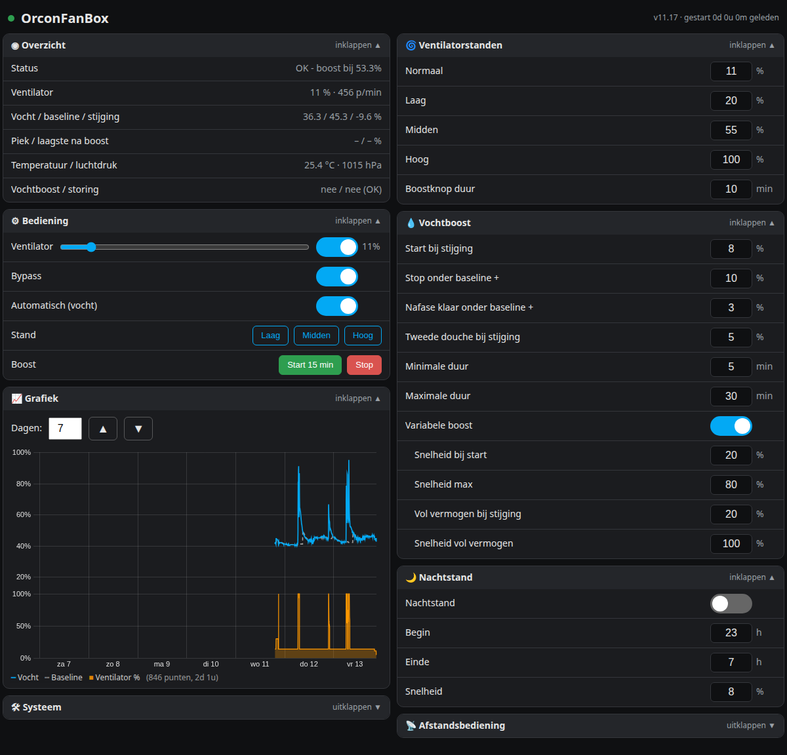
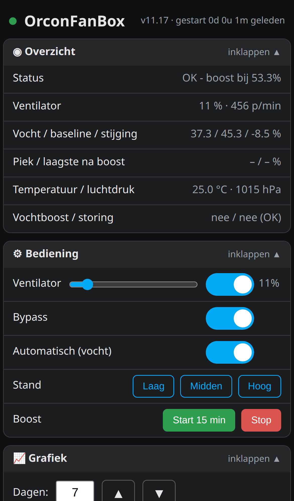
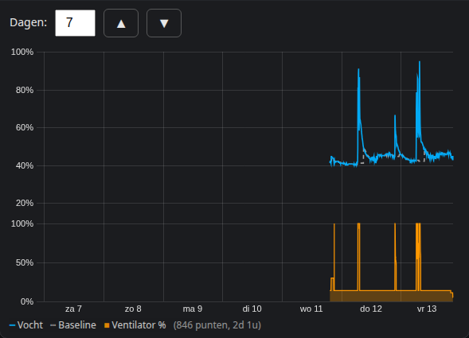

# Orcon MVS-15 Home Assistant – OrconFanBox

ESPHome firmware **v11.17** for a D1 mini (ESP8266) that controls an **Orcon MVS-15** ventilation unit, with a humidity-driven variable boost, its own web page, a 7-day chart and full Home Assistant integration.

| Phone | 7-day chart |
|---|---|
|  |  |

[OrconWifiController product page on Tindie](https://www.tindie.com/products/hjhickinson/orconwificontroller-for-orcon-mvs-15/)

---

## Nederlands

ESPHome-firmware en documentatie voor het bedienen van een Orcon MVS-15 met Home Assistant.

- vochtgestuurde **variabele boost** met geleidelijke afbouw, nafase en herkenning van een tweede douchebeurt;
- standen Laag/Midden/Hoog, boostknop, nachtstand en uitlezing van de originele afstandsbediening;
- alle instellingen in één vast opslagblok: ze overleven herstart, stroomstoring en update;
- **grafiek van 7 dagen** in de flash (vocht, baseline, ventilator), aantal dagen zelf te kiezen;
- eigen overzichtelijke **webpagina** voor pc en telefoon, met inklapbare groepen;
- diagnosepagina `/diag`.

[Open de volledige Nederlandse handleiding](NL/README.md)

## English

ESPHome firmware and documentation to control an Orcon MVS-15 with Home Assistant.

- humidity-driven **variable boost** with gradual ramp-down, after-phase and second-shower detection;
- Low/Medium/High presets, boost button, night mode and reading of the original remote control;
- all settings in one fixed storage block: they survive restarts, power loss and updates;
- **7-day chart** stored in flash (humidity, baseline, fan), selectable number of days;
- its own clear **web page** for PC and phone, with collapsible groups;
- diagnostics page `/diag`.

[Open the complete English guide](EN/README.md)

## Deutsch

ESPHome-Firmware und Dokumentation zur Steuerung einer Orcon MVS-15 mit Home Assistant.

- feuchtegesteuerter **variabler Boost** mit schrittweiser Absenkung, Nachphase und Erkennung einer zweiten Dusche;
- Stufen Niedrig/Mittel/Hoch, Boost-Taste, Nachtmodus und Auswertung der originalen Fernbedienung;
- alle Einstellungen in einem festen Speicherblock: sie überstehen Neustart, Stromausfall und Update;
- **7-Tage-Diagramm** im Flash (Feuchte, Baseline, Lüfter), Anzahl der Tage frei wählbar;
- eigene übersichtliche **Webseite** für PC und Smartphone, mit einklappbaren Gruppen;
- Diagnoseseite `/diag`.

[Vollständige deutsche Anleitung öffnen](DE/README.md)

---

## Firmware

All files are in [`firmware/`](firmware). Copy them together into your ESPHome folder and create `secrets.yaml` from [`firmware/secrets.example.yaml`](firmware/secrets.example.yaml).

> [!WARNING]
> Disconnect mains power before working on the unit and have work on 230 V carried out by a qualified person.
